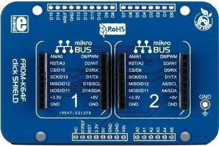
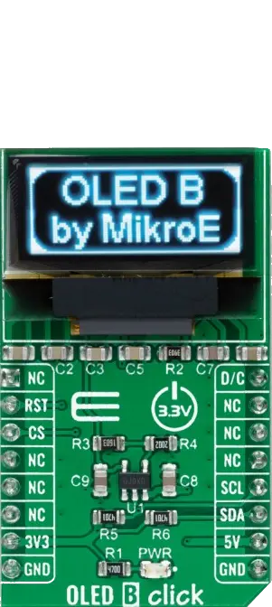
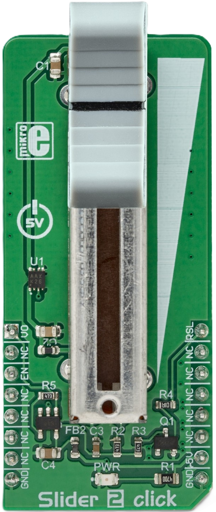
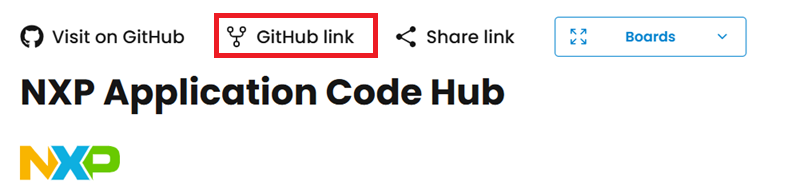

# NXP Application Code Hub

## Analog Slider Read on OLED Display
This example demonstrates an analog slider reader running on the FRDM-A-S32K118 evaluation board. The analog output of a Slider 2 Click module is sampled by the on-chip ADC and the resulting value is shown on an SSD1306 OLED screen over the FlexIO-based I2C interface, while the LPUART peripheral periodically reports the slider value to a host terminal. GPIO lines are used to enable the Slider 2 Click module and to select its voltage reference.

#### Boards: FRDM-A-S32K118
#### Categories: User Interface, Sensor
#### Peripherals: UART, FlexIO, ADC, GPIO
#### Toolchains: S32 Design Studio IDE

## Table of Contents
1. [Software and Tools](#step1)
2. [Hardware](#step2)
3. [Setup](#step3)
4. [Results](#step4)
5. [Support](#step5)
6. [Release Notes](#step6)

## 1. Software and Tools
This example was developed using the FRDM Automotive Bundle for S32K1. To download and install the complete software and tools ecosystem, use the following link: 
- [ S32K1 FRDM Automotive Board Installation Package](https://www.nxp.com/app-autopackagemgr/automotive-software-package-manager:AUTO-SW-PACKAGE-MANAGER?currentTab=0&selectedDevices=S32K1&applicationVersionID=155)

## 2. Hardware
### 2.1 Required Hardware
- Personal Computer
- Type-C USB cable

| Boards | Images |
| ----------- | ------- |
| - [FRDM-A-S32K118](https://www.nxp.com/design/design-center/development-boards-and-designs/FRDM-A-S32K118) |  |
| - [FRDM K64 click shield](https://www.mikroe.com/frdm-k64-click-shield) | 

 |
| - [OLED B Click](https://www.mikroe.com/oled-b-click)   - [Slider 2 Click](https://www.mikroe.com/slider-2-click)   | 
  |

### 2.2 Hardware Connections
| FRDM-A-S32K118   | Header Pin |I/O| FRDM Shield  | Click Board / Module | Pin       | Description             |
|------------------|------------|---|--------------|----------------------|-----------|-------------------------|
| PTA14 FlexIO_D14 | J4 pin 17  | → | D14/SDA      | OLED B Click         | SDA       | FlexIO I2C SDA Pin      |
| PTA9  FlexIO_D7  | J4 pin 19  | → | D15/SCL      | OLED B Click         | SCL       | FlexIO I2C SCL Pin      |
| PTA14 GPIO       | J8 pin 8   | → | RST/A3       | OLED B Click         | RST       | Display reset           |
| PTA9 GPIO        | J4 pin 6   | → | CS/D10       | OLED B Click         | CS        | Display chip select     |
| PTC0 ADC0_SE8    | J4 pin 1   | ← | AN/A0        | Slider 2 Click       | V0        | Analog slider output    |
| PTE9 GPIO        | J4 pin 3   | → | CS/D9        | Slider 2 Click       | EN        | Slider enable           |
| PTE8 GPIO        | J5 pin 12  | → | D5/PWM       | Slider 2 Click       | RSL       | Voltage reference select|
| GND              | JA3 pin 13 | → | GND          | All modules          | GND       | Ground                  |
| VDD_PERH         | JA3 pin 7  | → | 3.3V         | All modules          | 3V3       | Power Supply            |

### 2.3 Debugger Connection
- Connect the Type-C USB cable to PC and FRDM-A-S32K118 board for power supply and debugging

## 3. Setup

### 3.1 Import the Project into S32 Design Studio IDE
1. Open S32 Design Studio IDE, in the Dashboard Panel, choose **Import project from Application Code Hub**.
[

](./images/import_project_1.png)

2. Find the demo you need by searching for the name directly. 
Open the project, click on the **GitHub link** from this window, S32 Design Studio IDE will automatically retrieve project attributes, then click **Next>**.
[

](./images/import_project_3.png)

3. Select **main** branch and then click **Next>**.
4. Select your local path for the repo in **Destination->Directory** window. The S32 Design Studio IDE will clone the repo into this path, click **Next>**.

5. Select **Import existing Eclipse projects** then click **Next>**.

6. Select the project in this repo (only one project in this repo) then click **Finish**.
### 3.2 Generating, Building and Running the Example
1. In Project Explorer, right-click the project and select **Update Code and Build Project**. This will generate the configuration (Pins, Clocks, Peripherals), update the source code and build the project using the active configuration (e.g. Debug_FLASH).
Make sure the build completes successfully and the *.elf file is generated without errors.
[

](./images/update_and_build.png)
Press **Yes** in the **SDK Component Management** pop-up window to continue.

2. Go to **Debug** and select **Debug Configurations**. There will be a debug configuration for this project:
[

](./images/Debug_config.png)

        Configuration Name                  Description
        -------------------------------     -----------------------
        $(example)_debug_flash_pemicro      Debug the FLASH configuration using PEmicro probe

    Select the desired debug configuration and click on **Debug**. Now the perspective will change to the **Debug Perspective**.
    Use the controls to control the program flow.

2. Go to **Debug** and select **Debug Configurations**. There will be a debug configuration for this project:
[

](./images/Debug_config.png)

        Configuration Name                  Description
        -------------------------------     -----------------------
        $(example)_debug_flash_pemicro      Debug the FLASH configuration using PEmicro probe

    Select the desired debug configuration and click on **Debug**. Now the perspective will change to the **Debug Perspective**.
    Use the controls to control the program flow.

## 4. Results
The demo combines a Slider 2 Click analog slider sampled by the on-chip ADC with an SSD1306 OLED display and UART reporting to deliver a simple, real-time analog input reader:

- **Startup Sequence:** On power-up, a startup screen showing the board name and "Slider 2 Click" is displayed on the OLED, while initialization status messages are streamed over UART. The Slider 2 Click module is enabled through its EN line and its voltage reference is selected through the RSL line before the ADC is calibrated.

- **ADC Calibration:** During initialization the on-chip ADC performs a self-calibration cycle. The application waits until calibration completes successfully before entering the main loop, ensuring accurate slider readings.

- **OLED Display Layout:** The main screen shows an "ADC Value:" header with the current 12-bit slider sample displayed below it in a large, easy-to-read font. The value is refreshed every 200 ms as the slider is moved.

- **Slider Monitoring:** The analog output of the Slider 2 Click is continuously sampled on the ADC channel. Each conversion returns a 12-bit value (0-4095) that tracks the physical position of the slider in real time.

- **UART Reporting:** Once every second, the current slider ADC value is reported over the LPUART peripheral, providing an always-on log of the slider position on a host terminal.

## 5. Support
For general technical questions related to NXP microcontrollers, please use the *NXP Community Forum*.
#### Project Metadata

<!----- Boards ----->

<!----- Categories ----->

<!----- Peripherals ----->

<!----- Toolchains ----->

Questions regarding the content/correctness of this example can be entered as Issues within this GitHub repository.

>**Note**: For more general technical questions regarding NXP Microcontrollers and the difference in expected functionality, enter your questions on the [NXP Community Forum](https://community.nxp.com/)

## 6. Release Notes
| Version | Description / Update                           | Date                        |
|:-------:|------------------------------------------------|----------------------------:|
| 1.0     | Initial release on Application Code Hub        | October 13th 2026  |
